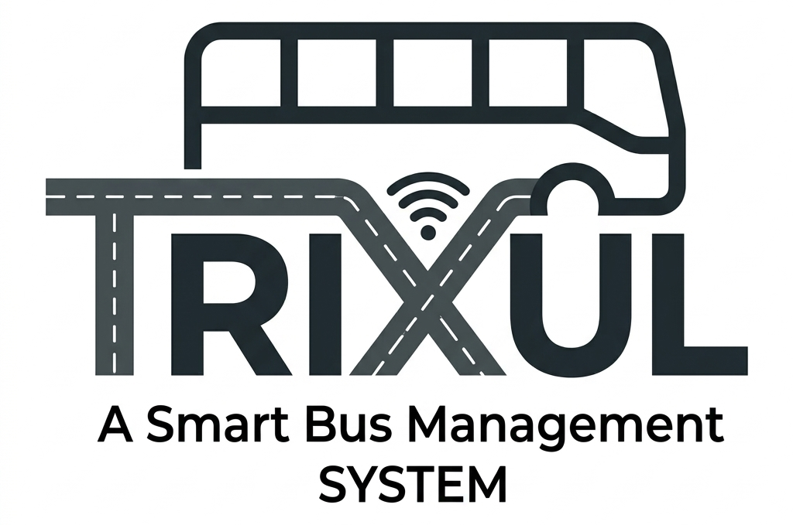

<div align="center">
  

  # TRIXUL
  ### Next-Gen Intelligent Transit & Fleet Orchestration Platform

  [](https://www.python.org/)
  [](https://www.djangoproject.com/)
  [](https://postgis.net/)
  [](https://react.dev/)
  [](https://expo.dev/)
  [](https://tailwindcss.com/)
  [](#-platform-roadmap)
</div>

---

## 📌 What is TRIXUL?

**TRIXUL** is an end-to-end, enterprise-grade public transport management and Automated Fare Collection System (AFCS). Inspired by real-world intercity transit operations like the Maharashtra State Road Transport Corporation (MSRTC), TRIXUL digitizes the entire lifecycle of bus transit:

1. **At the Vehicle Level (ETM Node):** Equips bus conductors with rugged, offline-first Electronic Ticket Machines for one-handed fare issuance, automated government welfare deductions (e.g., Mahila Sanman Yojana 50% discount, 75+ free travel), 10-second GPS telemetry, and bump-proof emergency SOS reporting.
2. **At the Headquarters Level (Admin Command Center):** Provides depot managers with an operational command center displaying live fleet radar, 45-passenger route saturation alerts, instant mid-shift bus swap controls for breakdowns, dynamic fare controls (midday discounts), and automated end-of-shift cash vs. UPI financial reconciliation.
3. **At the Database Core (Central Brain):** Employs GeoDjango and PostgreSQL with PostGIS extensions to perform high-speed spatial calculations (live distance to upcoming stops, automated ETA projections, passenger load analytics) with zero mock or synthetic fallback layers.

---

## 🏗️ Monorepo Architecture

TRIXUL is organized as a unified monorepo divided into dedicated, clean sub-products:

```text
TRIXUL/
├── Backend/                 # Django 4.2 + PostGIS Central Brain
│   ├── core/                # Models, Fat Services, Thin Views, Serializers, URLs
│   ├── management/commands/ # Idempotent demo database seeder (seed_trixul.py)
│   ├── scripts/             # End-to-end 23-endpoint test suite & validation runners
│   └── requirements.txt     # Python backend dependencies
│
├── Admin-Dashboard/         # Web Command Center (React 18 + Vite + Tailwind CSS)
│   ├── src/api/             # Axios client & centralized REST services
│   ├── src/components/      # Persistent revenue HUD, Leaflet fleet radar, modal builders
│   ├── src/hooks/           # Real-time 10s polling hooks for fleet, revenue, and incidents
│   └── src/pages/           # Live Dashboard, Fleet HUD, Shift Dispatcher, Revenue, Incidents, Route Manager
│
├── ETM-Interface/           # Conductor Electronic Ticket Machine (React Native / Expo)
│   ├── src/components/      # Thumb-steppers, smart stop chips, MetricPill, TicketTile
│   ├── src/screens/         # Ticketing, GPS status, Emergency Alert, Reconciliation, Fleet Directory
│   ├── src/services/        # Axios API bridge, encrypted storage, and offline batch queue
│   ├── src/store/           # Redux Toolkit store (conductor, route, ticket, bus, alerts, updates)
│   └── src/utils/           # Dynamic fare calculator and government concession engines
│
└── Presentation/            # Platform assets, architecture decks, and visual branding
    └── Trixul.jpeg          # Official platform emblem
```

---

## ⚡ Core Platform Capabilities

### 1. Zero-Mock Data Integrity
All analytics, financial totals, and live statuses pull from real-time PostgreSQL queries. Every ticket issued directly updates the route passenger volume, driver cash/UPI audit logs, and global command center metrics.

### 2. High-Speed PostGIS Telemetry & Dynamic ETAs
Conductor terminals broadcast 10-second GPS telemetry (`latitude`, `longitude`, `speed`). The backend uses PostGIS spatial functions (`Distance()`, `ST_Distance_Sphere`) to match the bus to its route stop sequence, calculate the next stop, and compute dynamic arrival times.

### 3. Rural Dead-Zone Batch Ingestion (`POST /api/v1/sync/batch/`)
When buses pass through cellular blind spots, tickets are saved to encrypted on-device storage. Once a network handshake is re-established, the ETM executes an atomic batch ingestion to sync all tickets into PostgreSQL without duplicates or data loss.

### 4. Dynamic Mid-Shift Bus Swap Protocol
If a bus breaks down on the highway, depot controllers can dynamically reassign a replacement bus to the active shift via the command center. The conductor's terminal automatically updates to the new vehicle registration during the next heartbeat without resetting passenger logs or shift revenue.

### 5. Rugged "Slide to SOS" Emergency Gesture
On bumpy rural roads, standard touch buttons can be triggered accidentally. The ETM incorporates a physical swipe-to-confirm slider component that requires a deliberate horizontal gesture before broadcasting an emergency alarm to depot dispatch.

### 6. Dynamic Fare Control & Concessions
Depot managers can push instantaneous off-peak midday discounts (e.g., 10% off) or toggle government welfare concession rules (Mahila Sanman Yojana, Senior Citizens, Child half-fare) across the fleet in real time.

---

## 🚦 Platform Roadmap & Milestones

| Stage | Focus Area | Status | Key Deliverables |
| :---: | :--- | :---: | :--- |
| **Stage 1 & 2** | **ETM Node & Central Brain** | ✅ **100% Complete** | Django/PostGIS schema, Conductor UI, thumb-steppers, GPS heartbeat, ticket issue, offline batch ingestion, shift closure. |
| **Stage 3** | **Admin Command Center** | ✅ **100% Complete** | React 18 HUD, live Leaflet radar, 45-pax route saturation alerts, 1-click surge deploy, mid-shift bus swap, incident state machine, dynamic fare control. |
| **Stage 4** | **Public Passenger Platform** | 🔄 *Next Sprint* | Commuter React Native app, live map bus tracking, crowd saturation badges (Green/Yellow/Red), digital QR boarding passes. |
| **Stage 5** | **AI & Predictive Optimization** | 📋 *Backlog* | XGBoost route volume forecasting 24-48h in advance, Origin-Destination (O/D) matrix reconstruction, traffic-aware LSTM arrival models. |
| **Stage 6** | **Cloud & Hardware Integration** | 📋 *Backlog* | Production cloud migration, ESC/POS Bluetooth thermal receipt printers, NFC/RFID contactless tap-to-pay smart card scanners. |

---

## 🏁 Getting Started

### 1. Boot the Backend (Django + PostgreSQL)

```bash
# Navigate to Backend
cd Backend

# Create & activate virtual environment
python3 -m venv venv
source venv/bin/activate

# Install dependencies
pip install -r requirements.txt

# Configure environment variables
cp .env.example .env
# Ensure your PostgreSQL & PostGIS credentials are set in .env

# Run migrations & seed demo data
python manage.py migrate
python manage.py seed_trixul

# Start Django API server
python manage.py runserver 0.0.0.0:8000
```

> **Run Test Suite:** Verify all 23 API endpoints anytime with:
> ```bash
> python scripts/test_all_endpoints.py
> ```

---

### 2. Boot the Admin Command Center (Web)

```bash
# In a new terminal:
cd Admin-Dashboard

# Install packages
npm install

# Configure environment
cp .env.example .env
# Set: VITE_API_BASE_URL=http://localhost:8000

# Start Vite development server
npm run dev
# Command center will open at http://localhost:5173
```

---

### 3. Boot the ETM Interface (Conductor App)

```bash
# In a new terminal:
cd ETM-Interface

# Install packages
npm install

# Start Expo development server
npm run web       # Launch in browser
# or
npm run android   # Launch on Android emulator or physical device
```

---

## 📡 API Reference Overview

| Endpoint | Method | Component | Purpose |
| :--- | :---: | :---: | :--- |
| `/api/v1/auth/login/` | `POST` | ETM | Conductor authentication & assigned shift retrieval |
| `/api/v1/routes/<id>/` | `GET` | ETM | Route sequence, PostGIS stops, and fare matrix initialization |
| `/api/v1/telemetry/heartbeat/` | `POST` | ETM | 10-second GPS telemetry ping with PostGIS ETA calculation |
| `/api/v1/ticketing/issue/` | `POST` | ETM | Issue single or group ticket to PostgreSQL |
| `/api/v1/sync/batch/` | `POST` | ETM | Atomic batch ingestion of queued offline tickets |
| `/api/v1/ticketing/shift/<id>/summary/` | `GET` | ETM / Admin | Live shift reconciliation (Cash vs. UPI) |
| `/api/v1/admin/fleet/` | `GET` | Admin / ETM | Real-time vehicle positions, speed, occupancy, and AI alerts |
| `/api/v1/admin/dispatch-options/` | `GET` | Admin | Registered conductors, buses, and routes directory |
| `/api/v1/admin/shifts/` | `GET` / `POST` | Admin | List shifts / Dispatch new shift to wake ETM |
| `/api/v1/admin/shifts/<id>/close/` | `POST` | Admin | Shift closure & depot reconciliation |
| `/api/v1/admin/shifts/<id>/reassign-bus/` | `POST` | Admin | Mid-shift vehicle swap on highway breakdowns |
| `/api/v1/admin/revenue/` | `GET` | Admin | Financial breakdown (Cash vs. UPI, route & conductor rankings) |
| `/api/v1/admin/incidents/` | `GET` / `POST` | Admin / ETM | Incident reporting & control center alert queue |
| `/api/v1/admin/incidents/<id>/acknowledge/` | `PATCH` | Admin | Acknowledge and silence emergency SOS alarms |
| `/api/v1/admin/fare-controls/` | `GET` / `POST` | Admin | Dynamic tariff control & midday discount pushes |
| `/api/v1/admin/routes/` | `GET` | Admin | Route and stop sequence index |
| `/api/v1/admin/routes/create/` | `POST` | Admin | Visual route builder and fare rule deployer |
| `/api/v1/admin/stops/` | `GET` / `POST` | Admin | Map-click GPS stop registration |

---

## 👥 Authors & Team

Developed as an integrated public transport innovation platform by the **TRIXUL Engineering Team**.
